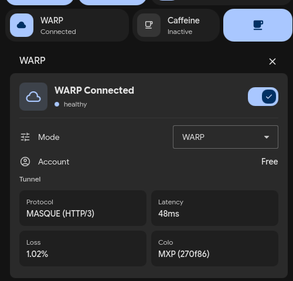

# dms-warp-toggle

A minimal DankMaterialShell plugin that toggles Cloudflare WARP via `warp-cli` with live status, mode switching, and tunnel stats.

## Features

- **Real-time status** — Uses `warp-cli -l status` live stream for instant state updates
- **Mode switching** — Change the WARP operating mode (WARP, DoH, DoT, proxy, tunnel-only) without leaving the popout
- **Account and tunnel details** — Shows account type, Teams organization, protocol, colo, latency, loss, and transfer totals
- **Semantic status colors** — Green connected, amber connecting, red unavailable, neutral disconnected
- **Minimal & polished** — Card-based UI with badge-style bar pill, spinner animation, and a clean popout panel following DMS Material 3 design
- **No DBus, no native bindings** — Interacts with WARP exclusively via subprocess calls
- **Settings** — Toggle the listener, manual refresh

## Requirements

- `warp-cli` installed and available in `$PATH`
- DankMaterialShell >= 1.4.0

## Permissions

- `process` — spawn `warp-cli` subprocesses
- `settings_read` / `settings_write` — persist plugin preferences

## Usage

- Click the bar pill or Control Center tile to toggle WARP: connected disconnects, anything else connects
- Right-click the bar pill to open the popout
- Expand the widget to see status, mode, account, tunnel stats, and the toggle button
- Change the mode from the dropdown in the detail card or popout; if WARP was connected, it reconnects automatically after the mode change
- Open plugin settings to configure the listener behavior

## Files

| File | Description |
|------|-------------|
| `plugin.json` | Plugin manifest |
| `WarpToggle.qml` | Main UI component (bar pill + popout) |
| `WarpToggleService.qml` | Singleton service (listener process + toggle logic) |
| `WarpToggleSettings.qml` | Settings panel |
| `components/WarpStatusCard.qml` | Shared status, mode, account and tunnel stats card |
| `qmldir` | QML singleton registration |

## License

MIT
